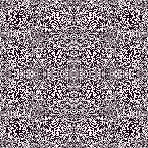
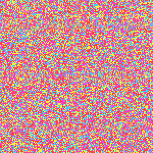
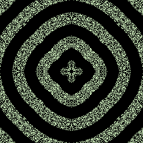
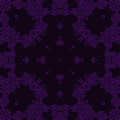
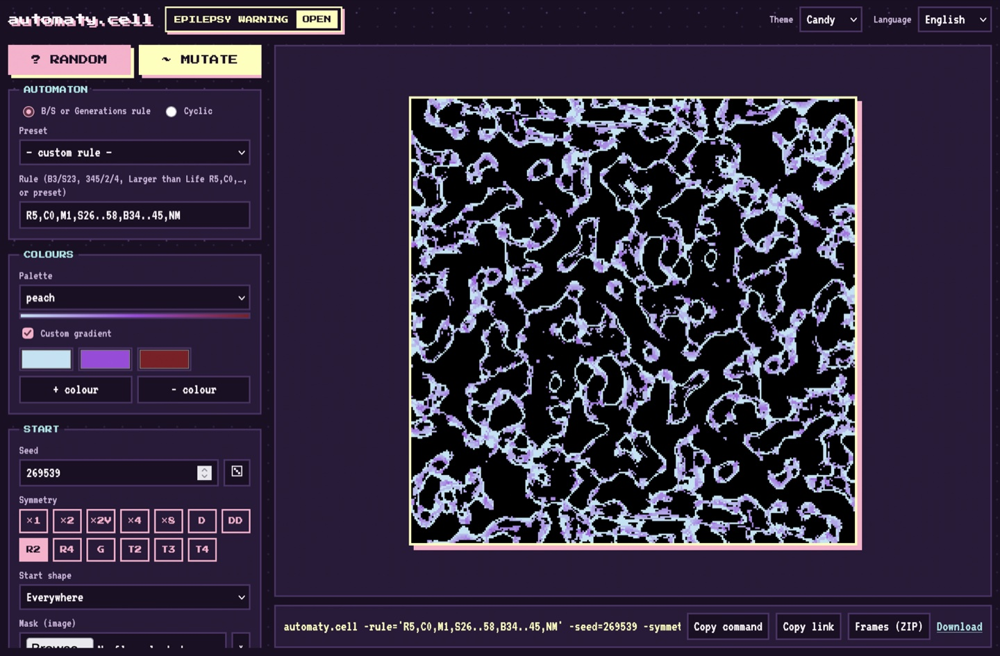
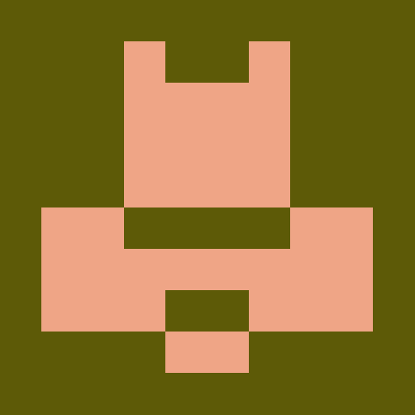
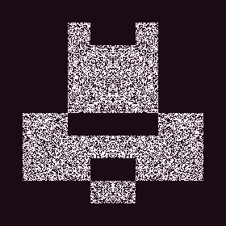

<h1 align="center">automaty.cell</h1>

<p align="center">
  10<sup>38</sup> automates cellulaires → GIF, PNG et séquences pour le mapping vidéo,<br>
  depuis la ligne de commande, une page web ou ton agent IA (MCP)<br>
  <sub>règles × graines × symétries × formes × palettes, avant même la densité, la taille de la grille ou tes propres couleurs</sub>
</p>

<p align="center"><sub>v0.5.0 · Go 1.22+ · zéro dépendance · MIT</sub></p>

<p align="center">
  <a href="#page-web">Page web</a> ·
  <a href="#les-quatre-du-haut">Exemples</a> ·
  <a href="#sur-ton-image">Sur une image</a> ·
  <a href="#fonctionnalités">Fonctionnalités</a> ·
  <a href="#agents-mcp">Agents</a> ·
  <a href="OPTIONS.md">Options</a> ·
  <a href="README.md">English</a>
</p>

<table align="center">
  <tr>
    <td align="center"><br><sub>Globe, en miroir par quatre</sub></td>
    <td align="center"><br><sub>Cyclique, couleurs perso</sub></td>
  </tr>
  <tr>
    <td align="center"><br><sub>Generations 24/234/6, symétrie 8, aller-retour</sub></td>
    <td align="center"><br><sub>Gray-Scott mitosis qui devient reef, symétrie 8</sub></td>
  </tr>
</table>

Des images (PNG), des animations (GIF) et des séquences d'images (ZIP)
procédurales tirées d'automates cellulaires 2D, en ligne de commande, en page
web et en serveur MCP pour les agents.

Télécharge un binaire pour macOS, Linux ou Windows depuis la
[dernière release](https://github.com/te-o-o-o/automaty.cell/releases/latest)
(sur macOS, d'abord `xattr -d com.apple.quarantine automaty.cell-*`, car il
n'est pas signé), ou avec Go :

```
go install github.com/te-o-o-o/automaty.cell@latest
```

## Page web

<table align="center">
  <tr>
    <td align="center"><br><sub>La page web (<code>-serve</code>), thème Bonbon</sub></td>
  </tr>
</table>

```
./automaty.cell -serve :8080
```

Chaque option a son champ et l'image se recalcule à chaque changement, avec sa
ligne de commande en dessous. **? RANDOM** tire des réglages vivants,
**Muter** explore les voisines d'une règle qui te plaît, et le lien de la page
garde ses réglages, pour partager une création. Même moteur que la ligne de
commande, avec des limites pour un usage en ligne (grilles jusqu'à 500×500, GIF
jusqu'à environ 80 Mo). La page existe en anglais et en français.

## Les quatre du haut

Pour charger plus vite, les GIF Globe, Generations et Gray-Scott du haut ne
gardent qu'une image sur deux ; ces commandes donnent les versions complètes.

```
# Larger than Life (Globe), en miroir par quatre
./automaty.cell -rule globe -symmetry 4 -density 0.5 -w 300 -h 300 -scale 1 -gens 120 -delay 6 -palette candy -o blobs.gif

# Un automate cyclique en couleurs perso
./automaty.cell -cyclic -states 4 -threshold 3 -neighborhood moore -w 150 -h 150 -gens 120 -delay 6 -colors ff3b3b,ff3ee0,f7f33c,3ed4f7 -o swirls.gif

# Une règle Generations partie d'une spirale, symétrie 8, en boucle aller-retour
./automaty.cell -rule=24/234/6 -seed=195067 -symmetry=8 -shape=spiral -density=0.47 -gens=60 -delay=2 -pingpong=true -w=280 -h=280 -scale=1 -colors='d2f2c0,1a6c7f,00e9f2,ff00fe' -o spiral.gif

# Réaction-diffusion de Gray-Scott : des taches qui se divisent, puis deviennent corail à la génération 90
./automaty.cell -rule=mitosis -symmetry=8 -w=240 -h=240 -scale=1 -gens=180 -delay=4 -palette=berry -at=90:rule=reef -o mitosis-reef.gif
```

## Sur ton image

N'importe quel PNG ou JPEG devient un masque : l'automate ne vit que dans ses
zones claires (ou opaques, pour un logo détouré), prêt à être projeté sur une
façade ou un logo.

<table align="center">
  <tr>
    <td align="center"><br><sub>L'image</sub></td>
    <td align="center"><br><sub>L'automate, gardé dedans</sub></td>
  </tr>
</table>

```
./automaty.cell -rule=03468/23/6 -palette=candy -seed=477752 -symmetry=2 -density=0.57 -delay=6 -pingpong=true -w=280 -h=280 -scale=1 -mask=spaceship.png -o spaceship.gif
```

## Fonctionnalités

- **Règles** : toute règle B/S (Jeu de la vie et compagnie, en notation Golly),
  Generations, Larger than Life sur de grands voisinages, automates cycliques,
  et réaction-diffusion de Gray-Scott pour des coraux, des taches et des
  empreintes digitales. 26 préréglages nommés (`-list-rules`).
- **Départs** : aléatoire ou îlots de bruit de Perlin, symétries miroir,
  rotation, glissée et en tuiles, formes (disque, anneau, spirale…),
  mathusalems, ou un masque d'image à projeter sur une façade.
- **Changements en cours de route** avec `-at` : change de règle, de palette ou
  de bords à une génération donnée, les cellules continuent.
- **Sortie** : la dernière génération en PNG, un GIF animé (boucles
  aller-retour avec `-pingpong`, arrêt dès que ça se fige ou boucle avec
  `-stop`), ou un PNG par génération dans un ZIP pour Resolume, MadMapper,
  TouchDesigner… 23 palettes, ou tes propres couleurs.

Chaque option en une phrase : [OPTIONS.md](OPTIONS.md) (en anglais) ; valeurs
par défaut : `./automaty.cell -h`.

## Agents (MCP)

`-mcp` sert le [Model Context Protocol](https://modelcontextprotocol.io) sur
stdin/stdout : décris ce que tu veux à un agent et il le génère. Son unique
outil, `render`, prend les options de la ligne de commande, écrit le fichier et
montre à l'agent une planche de 6 générations avec un verdict (éteint, figé,
remplit la grille…) pour qu'il ajuste. Mêmes limites que la page web.

```
claude mcp add automaty -- /chemin/vers/automaty.cell -mcp
```

Pour Claude Desktop, dans `claude_desktop_config.json` :

```json
{ "mcpServers": { "automaty": { "command": "/chemin/vers/automaty.cell", "args": ["-mcp"] } } }
```

## Tests

```
go test ./...
```

## Licence

MIT, voir [LICENSE](LICENSE).
